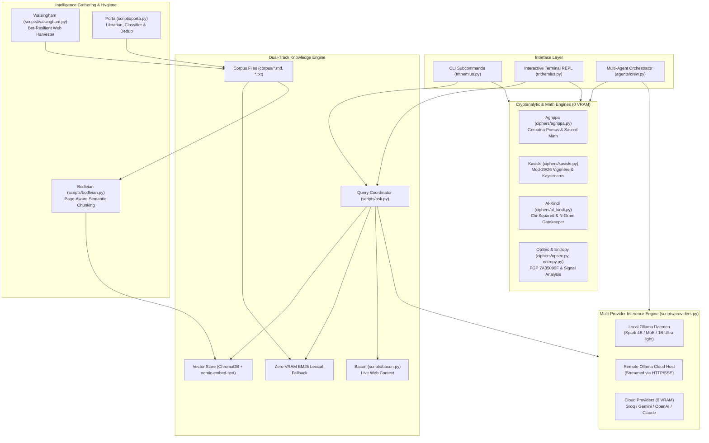

# Trithemius Cryptanalytic Workstation: Technical Specification & Feature Synthesis

This document provides a comprehensive technical overview of the Trithemius cryptanalytic workstation, detailing its architecture, cryptographic subsystems, multi-provider inference engine, retrieval pipelines, intelligence gathering framework, and multi-agent coordination system. It is designed to provide complete context for engineers, cryptanalysts, or AI systems reviewing, auditing, or contributing to the project.

---

## 1. System Overview & Core Philosophy

Trithemius is an offline-first, terminal-centric cryptanalytic research workstation purpose-built for investigating the Cicada 3301 mystery and deciphering the unsolved pages of the *Liber Primus* manuscript. Named after Johannes Trithemius (1462–1516), the Benedictine abbot who authored *Steganographia* and *Polygraphia*, the software combines classical Renaissance polyalphabetic cryptanalysis, sacred number theory, and modern natural language processing.

The workstation operates across two primary paradigms:
1. **Deterministic Cryptographic & Statistical Analysis**: Zero-overhead, pure-Python modules executing number-theoretic algorithms, Gematria Primus arithmetic, Modulo-29/26 Vigenère solvers, Shannon entropy profiling, and PGP key verification.
2. **Augmented Intelligence & RAG**: A dual-track retrieval-augmented generation engine that can operate entirely offline using local Ollama models or remote cloud endpoints (Groq, OpenAI, Google Gemini, Anthropic Claude, OpenRouter), supported by hybrid vector search and zero-VRAM BM25 lexical ranking.

---

## 2. Architecture & Component Inventory

The codebase is organized into modular libraries, each named after a historical scholar or cryptographer whose historical contributions match the component's domain.



---

## 3. Cryptographic & Sacred Arithmetic Engines

All cryptographic modules are written in native Python with LRU caching, operating in sub-millisecond execution times with zero GPU or machine learning dependencies.

### 3.1 Agrippa: Gematria Primus & Number Theory (`ciphers/agrippa.py`)
Agrippa encodes the official 29-rune Anglo-Saxon Futhorc alphabet used by Cicada 3301 in the *Liber Primus*, where each rune maps to an index ($0$ to $28$) and a sacred prime number ($2$ to $109$).
- **Bidirectional Transliteration**: Converts Latin text to runes and runes to Latin, preserving runic word separators (`᛫`), clause dividers (`᛬`), and section breaks (`᛭`). Handles multi-character English digraphs (`TH` $\to$ `ᚦ`, `ING` $\to$ `ᛝ`, `EO` $\to$ `ᛇ`, `OE` $\to$ `ᛟ`, `AE` $\to$ `ᚫ`, `IA`/`IO` $\to$ `ᛡ`, `EA` $\to$ `ᛠ`).
- **Gematria Prime Sums**: Calculates prime value sums for entire texts and individual words ($\sum \text{prime}(r)$).
- **Runic Atbash**: Applies runic alphabet inversion ($\text{index} \to 28 - \text{index}$).
- **Sacred Arithmetic**:
  - Deterministic $6k \pm 1$ primality testing with caching up to 32,768 entries.
  - Prime factorization via trial division and square root bounding.
  - Euler totient function $\phi(n)$ computation, essential for Cicada totient key derivations.

### 3.2 Kasiski: Vigenère Solver & Keystream Generator (`ciphers/kasiski.py`)
Named after Friedrich Kasiski, this module handles polyalphabetic substitution for both classical Latin alphabets and runic scripts.
- **Modulo-29 Runic Vigenère**: Encodes and decodes ciphertexts directly in rune space ($\text{mod } 29$). Supports word keys (e.g. `DIVINITY`) or numeric keystreams.
- **Modulo-26 Classical Vigenère**: Encodes and decodes standard A–Z English ciphertexts.
- **Dynamic Keystream Generators**: Generates mathematical keystreams used in Cicada puzzles: prime sequences ($2, 3, 5, 7, \dots$), Fibonacci sequences ($1, 1, 2, 3, 5, \dots$), and Euler totient streams ($\phi(1), \phi(2), \dots$).
- **Statistical Cryptanalysis**: Calculates Index of Coincidence (IoC), estimates key length across column slices, and recovers Caesar shifts using Chi-squared frequency minimization.

### 3.3 Al-Kindi: Statistical Gatekeeper (`ciphers/al_kindi.py`)
Named after the 9th-century polymath who invented frequency analysis, Al-Kindi verifies whether a candidate decryption is plausible English or random noise.
- **Chi-Squared Goodness-of-Fit**: Computes deviation from standard English letter distributions ($\chi^2 < 180$ indicates plausible natural language; random text yields $> 300$).
- **N-Gram Log-Likelihood**: Evaluates high-frequency trigrams (`THE`, `AND`, `ING`) and quadgrams (`TION`, `THAT`, `WITH`) scoring candidates between $0.0$ and $1.0$.
- **Dictionary Hit Ratio**: Validates plaintext against a 100-word lexicon of philosophical and common English terms prominent in Cicada texts.
- **Composite Verdict**: Assigns a classification (`PLAUSIBLE`, `UNCERTAIN`, `IMPLAUSIBLE`).

### 3.4 Taxonomy: Advanced $\mathbb{Z}_{29}$ Cryptanalytic Suite (`ciphers/taxonomy.py`)
Implements the comprehensive mathematical cryptanalysis taxonomy over the linear channel $\text{GF}(29)$ for recovering keys and deciphering unsolved Liber Primus pages:
- **Calibrated $\mathbb{Z}_{29}$ Runic Language Model**: 29-symbol unigram and $29 \times 29$ bigram log-likelihood models calibrated on verified Liber Primus solved pages with add-$k$ smoothing.
- **Statistical Triage Engine**: Computes unigram IC, normalized $\kappa = 29 \cdot \text{IC}$, bigram IC, and conditional entropy $H(X_n \mid X_{n-1})$ to diagnose Monoalphabetic, Periodic Polyalphabetic, Transposition, or Stream/OTP cipher families.
- **Consensus Period Detection**: Ensembles Kasiski weighted GCD voting on repeated $n$-grams, a Difference Periodogram comb filter measuring $\chi^2$ divergence across all 29 difference bins, and column-IoC scans with BIC penalty.
- **Separable Per-Column & T-Table Solvers**: Precomputes matrix $T[m][29]$ to recover optimal unigram keys in $O(29 \cdot m)$ time, Mutual Index of Coincidence (MIC) column alignment with 29-way gauge shift scans, and coupled hill climbing.
- **$O(m)$ Fast Dictionary Matching**: Screens thousands of candidate word keys in microseconds using the T-table trick.
- **Crib Dragging & Linear Recurrence**: Evaluates implied key fragments via Berlekamp–Massey over $\text{GF}(29)$, detects constant and linear finite differences, and matches fragments against an $O(1)$ precomputed stream hash bank (primes, totients, Fibonacci).
- **Surrogate-Data Null Hypothesis Testing**: Monte Carlo ciphertext shuffle tests ($N=50$) generating empirical $Z$-scores to prevent false-positive hallucination.
- **Persistent Ledger Integration**: Automatically records all explored hypotheses, parameters, and decryptions into the SQLite database (`agents/ledger.py`) with canonical SHA-256 deduplication.

---

## 4. Signal Intelligence & OpSec Verification

### 4.1 Cicada 3301 PGP Signature Verification (`ciphers/opsec.py`)
Cicada 3301 established that any communication not signed with their official PGP key is counterfeit.
- **PGP Block Inspection**: Detects armored ASCII PGP messages and signatures.
- **Key Authentication**: Verifies references and signatures against the official Cicada 3301 PGP Key ID `7A35090F` and full fingerprint `853F 5664 D046 F538 E6F5 6F14 4D2A 92E8 7A35 090F`.
- **File Header Magic Bytes**: Inspects file headers to identify file formats (PNG, JPEG, GIF, PDF, ZIP, ELF, Mach-O, Windows PE) and flags potential steganography containers.

### 4.2 Shannon Entropy & Signal Profiling (`ciphers/entropy.py`)
Calculates information density to distinguish plaintext from encrypted or compressed data.
- **Shannon Entropy**: Measures entropy $H(X) = -\sum p(x) \log_2 p(x)$ in bits per character ($0$ to $8$). High entropy ($> 7.2$) indicates encryption or compressed payloads; text entropy typically resides between $3.5$ and $5.0$.
- **4D Signal Feature Vector**: Extracts entropy, index of coincidence, chi-squared deviation, and byte variance to classify data as `CIPHERTEXT_OR_COMPRESSED`, `STRUCTURED_DATA`, or `NATURAL_LANGUAGE`.
- **Sliding-Window Boundary Detection**: Scans continuous binary streams for entropy transitions that indicate hidden payloads.

---

## 5. Intelligence Gathering & Corpus Management

### 5.1 Walsingham: Anti-Bot Web Intelligence Scout (`scripts/walsingham.py`)
Named after Queen Elizabeth I's spymaster, Walsingham gathers research and page transcripts autonomously from the web.
- **Multi-Engine Reconnaissance**: Queries DuckDuckGo Lite, DuckDuckGo API, Wikipedia Knowledge API, GitHub Solver Repositories, and the Internet Archive Wayback Machine.
- **Anti-Bot Resilience**: Automatically rotates realistic browser user-agents, applies exponential backoff with random jitter, and employs a circuit-breaker pattern to avoid IP bans.
- **Direct Verified Mirrors**: Contains fallback URLs and pre-seeded archival mirrors for crucial Liber Primus pages.
- **Content Authenticity Gate**: Evaluates fetched pages for Futhorc runes and research keywords before writing to `corpus/`.

### 5.2 Porta: Corpus Librarian & Normalizer (`scripts/porta.py`)
Named after Giambattista della Porta, author of *De Furtivis Literarum Notis* (1563).
- **Deduplication**: Generates SHA-256 digests to identify and clean redundant or duplicate files.
- **Automatic Classification & Renaming**: Inspects document contents, detects Liber Primus page numbers, and standardizes file names (`page_00_welcome.md`, `page_56_loss_of_innocence.md`).
- **Header Enrichment**: Injects standardized metadata (page number, rune counts, Gematria prime sum, PGP verification status).

### 5.3 Bodleian: Page-Aware Semantic Chunking (`scripts/bodleian.py`)
Named after Sir Thomas Bodley, founder of the Bodleian Library.
- **Smart Chunking**: Chunks text along paragraph boundaries with a target of 250 words, 40-word overlap, and an 1800-character ceiling.
- **Rune Annotation**: Identifies runes, calculates chunk Gematria sums, and appends Latin transliteration notes.
- **ChromaDB Ingestion**: Embeds chunks into persistent ChromaDB storage using `nomic-embed-text` with cosine similarity (`hnsw:space: cosine`).
- **Incremental Cache**: Uses file content hashing (`ingest_cache.json`) to skip re-indexing unchanged documents.

---

## 6. Multi-Provider Inference & Cloud Streaming Engine

Trithemius incorporates an inference architecture that allows it to operate across hardware environments without forcing local model downloads or GPU acceleration.

### 6.1 Provider Flexibility (`scripts/providers.py` & `config.py`)
The workstation supports six distinct backend providers:
- **Local Ollama**: Runs local models via the Ollama daemon (`http://localhost:11434`).
  - Standard models: `SparkLLM/Spark-X2.5-4B` and `deepseek-coder-v2:16b`.
  - Ultra-compact offline models: `qwen2.5:0.5b` (~400 MB RAM), `llama3.2:1b` (~1.2 GB RAM), `qwen2.5:1.5b` (~1.5 GB RAM).
- **Remote Ollama Cloud Streaming**: Connects to remote Ollama servers via `OLLAMA_HOST` (e.g. cloud VMs, RunPod, or tunnels) with optional bearer authorization (`OLLAMA_API_KEY`).
- **Groq Cloud (0 VRAM)**: Ultra-fast streaming of `llama-3.1-8b-instant` and `llama-3.3-70b-versatile` over SSE.
- **Google Gemini (0 VRAM)**: Native streaming via Gemini REST API (`gemini-1.5-flash`, `gemini-1.5-pro`).
- **OpenAI (0 VRAM)**: Streams `gpt-4o-mini` and `gpt-4o`.
- **Anthropic Claude (0 VRAM)**: Streams `claude-3-5-haiku-20241022` and `claude-3-5-sonnet-20241022`.
- **OpenRouter / OpenAI-Compatible (0 VRAM)**: Supports OpenRouter presets and generic self-hosted vLLM or LocalAI endpoints.

### 6.2 Credential Security & Persistence
API keys can be supplied via standard environment variables (`GROQ_API_KEY`, `OPENAI_API_KEY`, `GEMINI_API_KEY`, `ANTHROPIC_API_KEY`, `OPENROUTER_API_KEY`) or configured directly inside the workstation via `/key <provider> <key>`. Keys are persisted locally in `.env` with restricted user-only file permissions (`chmod 600`) and are never checked into version control.

### 6.3 Low-Spec Hardware Profile
For resource-constrained computers (e.g. 4–8 GB RAM or older CPUs):
- Activating `--low-spec` or `/profile low-spec` lowers the default context window from 8192 to 2048 tokens, cutting 2–4 GB of KV cache memory.
- Lazy module loading defers imports of heavy libraries (`chromadb`, `ollama`, `sqlite3`), enabling non-AI commands to start in 50ms and consume only ~25 MB of RAM.

---

## 7. Dual-Track RAG Pipeline & Zero-VRAM BM25 Fallback

The retrieval engine in `scripts/ask.py` employs a resilient fallback hierarchy:

1. **Vector Search (When Available)**: If ChromaDB and embedding models are active, queries are mapped to high-dimensional embeddings (`nomic-embed-text`) with page-level metadata filtering and hybrid rune reranking.
2. **Zero-VRAM BM25 Lexical Fallback**: If Ollama or embedding services are offline or if the user is running in cloud-only mode, the system falls back to a pure-Python BM25 ranking algorithm against `corpus/`.
   - Computes term frequency and inverse document frequency with document length normalization ($k_1 = 1.5, b = 0.75$).
   - Applies relevance boosts for Futhorc runes, Gematria terms, PGP signatures, and targeted Liber Primus page numbers.
   - Executes in $<10\text{ms}$ with zero memory or model overhead.
3. **Live Web Reconnaissance (Bacon)**: When requested via `/web <query>`, live web search snippets from DuckDuckGo are retrieved and merged into the context budget.
4. **Context Budgeting**: Strictly budgets retrieved context to 2500 characters, guaranteeing prompt evaluation times under 3 seconds while preserving source document provenance.

---

## 8. Multi-Agent Orchestration (`agents/`)

For complex cryptanalysis that exceeds single-prompt capabilities, Trithemius includes a multi-agent coordination layer built on CrewAI:
- **`agents/crew.py`**: Deploys a specialized team of autonomous agents equipped with custom tools (Agrippa rune decoding, Gematria prime calculations, Modulo-29 Vigenère decoding, Atbash transformation, sacred math factorization).
- **`agents/duel.py`**: Orchestrates adversarial cryptanalytic duels where two models propose, challenge, and verify competing decryption hypotheses against corpus constraints.
- **`agents/ledger.py`**: Maintains a persistent ledger of historical decryption attempts and test keys, preventing redundant compute.
- **`agents/regress.py`**: Runs regression test suites against verified Liber Primus solutions.

---

## 9. User Interfaces & Command Reference

### 9.1 Interactive REPL Commands
Launching `python3 trithemius.py` or `./start.sh` opens the interactive workstation REPL:

| Command | Syntax | Description |
|---|---|---|
| `/ask` | `/ask <query>` | Query the RAG engine against the Liber Primus corpus |
| `/web` | `/web <query>` | Query RAG with live web search reconnaissance |
| `/page` | `/page <number>` | Inspect transcript and previews of a specific Liber Primus page |
| `/gematria` | `/gematria <text_or_runes>` | Compute prime sum, totient, prime check, and Atbash |
| `/vigenere` | `/vigenere <enc\|dec> <text> <key>` | Solve Modulo-29 or Modulo-26 Vigenère cipher |
| `/crack` | `/crack <target> [--deep]` | Automated Liber Primus GF(29) Cryptanalytic Cascade Solver |
| `/triage` | `/triage <target>` | Statistical triage & cipher classification (IC, kappa, entropy) |
| `/period` | `/period <target> [max_p]` | Key length consensus & difference periodogram comb estimation |
| `/crib` | `/crib <target> <crib_word>` | Slide known crib for Berlekamp-Massey LC & stream matching |
| `/opsec` | `/opsec <text_or_path>` | Verify Cicada 3301 PGP key and compute Shannon entropy |
| `/organize` | `/organize` | Deduplicate and classify corpus documents via Porta |
| `/ingest` | `/ingest` | Index corpus into ChromaDB via Bodleian |
| `/status` | `/status` | Display provider, active model, profile, key status, and database metrics |
| `/provider` | `/provider <name>` | Switch active provider (`ollama`, `groq`, `openai`, `gemini`, etc.) |
| `/model` | `/model <key_or_name>` | Switch active model key or specify custom model string |
| `/key` | `/key <provider> <key>` | Store and persist a personal cloud API key in `.env` |
| `/key show` | `/key show` | Display masked configuration status of all API keys |
| `/host` | `/host <url>` | Set remote Ollama cloud streaming URL |
| `/profile` | `/profile <standard\|low-spec>` | Toggle hardware memory profile and context window limits |
| `/think` | `/think [on\|off]` | Toggle Chain-of-Thought (CoT) reasoning stream |

### 9.2 Direct CLI Subcommands
Individual commands can be executed directly from shell scripts without entering the REPL:
```bash
# Automated Cryptanalytic Taxonomy Solvers
python3 trithemius.py crack 56 --deep
python3 trithemius.py triage 56
python3 trithemius.py period 56
python3 trithemius.py crib 56 DIVINITY

# Classical & Runic Cipher Analysis
python3 trithemius.py gematria "ᚹᛖᛚᚳᚩᛗᛖ"
python3 trithemius.py vigenere dec "ᚹᛖᛚᚳᚩᛗᛖ" "DIVINITY"
python3 trithemius.py opsec corpus/page_73_an_end.md

# Cloud RAG query with 0 VRAM
python3 trithemius.py --provider groq --api-key <KEY> ask "Explain the loss of innocence in page 56"

# Low-spec execution with remote Ollama
python3 trithemius.py --low-spec --ollama-host http://remote-gpu:11434 ask "What is the totient of page 56?"
```

---

## 10. Automated Test & Regression Baseline

The test suite contains 115 automated unit and regression tests executing in under 2 seconds:
- `tests/test_cryptanalysis_taxonomy.py` (13 tests): Validates calibrated GF(29) language models, statistical triage, consensus period detection, difference periodograms, separable T-tables, Berlekamp–Massey linear complexity, stream hash bank matching, surrogate shuffle tests, and full cascade solvers.
- `tests/test_interrupter.py` (11 tests): Validates canonical 29-rune alphabet integrity, mathematical key shifts (DIVINITY, FIRFUMFERENFE), and bidirectional dynamic interrupter execution.
- `tests/test_router.py` (16 tests): Validates deterministic routing, exact Liber Primus transcript caching, and hybrid query dispatch.
- `tests/test_level1_optimizations.py` (11 tests): Validates Level 1 canonical deduplication and SQLite ledger migrations.
- `tests/test_providers.py` (8 tests): Validates Ollama streaming, Groq/OpenAI SSE parsing, Gemini SSE parsing, Anthropic message parsing, missing key validation, and bearer authorization headers.
- `tests/test_rag_chat.py` (11 tests): Validates prompt character budgeting, reasoning token streams, BM25 retrieval ranking, and zero-VRAM fallback.
- `tests/test_terminal_workstation.py` (14 tests): Validates Gematria arithmetic roundtrips, Mod-29/26 Vigenère solvers, OpSec PGP identification, Shannon entropy, and CLI telemetry.
- `tests/test_walsingham.py` (22 tests): Validates anti-bot web scraping, Wayback Machine fallbacks, User-Agent rotation, and archival mirror seeding.

Running the full suite:
```bash
./venv/bin/python -m unittest discover tests
```
