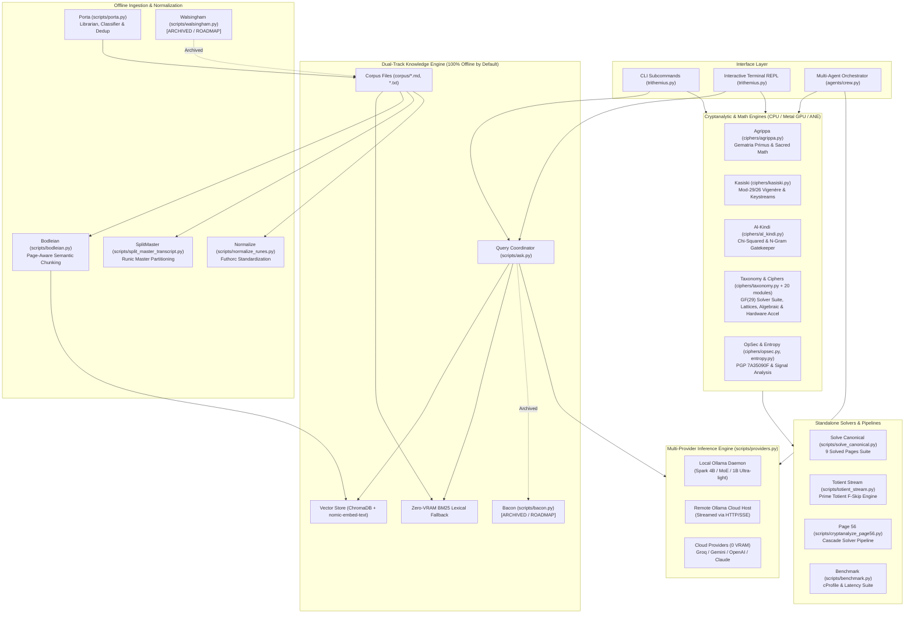

# Trithemius Cryptanalytic Workstation: Technical Specification & Feature Synthesis

This document provides a comprehensive technical overview of the Trithemius cryptanalytic workstation, detailing its architecture, cryptographic subsystems, multi-provider inference engine, retrieval pipelines, intelligence gathering framework, and multi-agent coordination system. It is designed to provide complete context for engineers, cryptanalysts, or AI systems reviewing, auditing, or contributing to the project.

---

## 1. System Overview & Core Philosophy

Trithemius is an offline-first, terminal-centric cryptanalytic research workstation purpose-built for investigating the Cicada 3301 mystery and deciphering the unsolved pages of the *Liber Primus* manuscript. Named after Johannes Trithemius (1462–1516), the Benedictine abbot who authored *Steganographia* and *Polygraphia*, the software combines classical Renaissance polyalphabetic cryptanalysis, sacred number theory, and modern natural language processing.

The workstation operates across two primary paradigms:
1. **Deterministic Cryptographic & Statistical Analysis**: Zero-overhead, pure-Python modules executing number-theoretic algorithms, Gematria Primus arithmetic, Modulo-29/26 Vigenère solvers, Shannon entropy profiling, and PGP key verification.
2. **Augmented Intelligence & RAG**: A dual-track retrieval-augmented generation engine that can operate entirely offline using local Ollama models or remote cloud endpoints (Groq, OpenAI, Google Gemini, Anthropic Claude, OpenRouter), supported by hybrid vector search and zero-VRAM BM25 lexical ranking.

---

## 2. Architecture & Component Inventory

The codebase is organized into modular libraries, each named after a historical scholar or cryptographer whose historical contributions match the component's domain.

Data ingestion, corpus normalization, and cryptanalytic execution operate **100% offline** via Bodleian, Porta, and verified curated transcripts in `corpus/`. External network intelligence harvesters (Walsingham and Bacon) are archived roadmap components; the workstation requires zero external network connectivity for corpus processing, vector embedding, or cryptanalysis.



### 2.1 Complete Script & Utility Inventory

The `scripts/` directory houses specialized data transformation utilities, standalone cryptanalytic solvers, inference coordinators, and benchmarking harnesses:

- **Ingestion, Normalization & Corpus Management**:
  - `scripts/bodleian.py`: Page-aware semantic chunker that splits text along paragraph boundaries with cryptographic metadata enrichment and embeds chunks into ChromaDB via `nomic-embed-text`.
  - `scripts/porta.py`: Corpus librarian and normalizer executing SHA-256 deduplication, automatic document classification, standardized naming, and cryptographic metadata injection.
  - `scripts/split_master_transcript.py`: Liber Primus runic master partitioning utility parsing master transcription (`corpus/liber-primus__transcription--master.txt`) into standardized individual page files (`corpus/page_{XX}_runes.md`) with delimiter preservation (interpuncts `᛫`, triple dots `᛭`, clause colons `᛬`, paragraph breaks `&`, section separators `$`, and line breaks `/`).
  - `scripts/normalize_runes.py`: Futhorc rune standardization and OCR cleaning utility that resolves inconsistent Unicode transliterations and validates characters against the official 29 Gematria Primus runes.
  - `scripts/walsingham.py` `[ARCHIVED / ROADMAP]`: Autonomous anti-bot web reconnaissance scout. Archived in favor of the 100% offline, reproducible Bodleian + Porta corpus pipeline.
- **Standalone Cryptanalytic Solvers & Pipelines**:
  - `scripts/solve_canonical.py`: Verification and automated solving suite faithfully reproducing the exact mathematical decryptions for all 9 historically solved Liber Primus pages against official Uncovering Cicada wiki reference plaintexts.
  - `scripts/totient_stream.py`: Standalone CLI decoder/encoder for the Liber Primus Prime Totient Stream cipher ($\phi(p_i) = p_i - 1 \bmod 29$) with cleartext Fehu pause (F-skip) handling.
  - `scripts/cryptanalyze_page56.py`: Automated cascade cryptanalysis pipeline targeting the authentic 273-rune transcript of Page 56 / 73, evaluating offset Euler totient streams, Pisano recurrence orbits in $\mathbb{F}_{29}$, and syntactic interrupters.
- **RAG, Inference & Benchmarking**:
  - `scripts/ask.py`: Dual-track retrieval-augmented generation coordinator with deterministic rule routing and hybrid vector/BM25 retrieval.
  - `scripts/providers.py`: Multi-provider LLM inference engine supporting local Ollama, remote Ollama instances, Groq, Google Gemini, OpenAI, Anthropic Claude, and OpenRouter streaming.
  - `scripts/benchmark.py`: Performance benchmark suite and profiling harness measuring cryptographic primitive latencies with microsecond precision, GC-safe execution, baseline persistence, and Python `cProfile` hotspot analysis.
  - `scripts/bacon.py` `[ARCHIVED / ROADMAP]`: Live web search reconnaissance bridge via DuckDuckGo. Archived in favor of deterministic offline local RAG; `/web` aliases to offline corpus search.

---

## 3. Cryptographic & Sacred Arithmetic Engines

All core cryptographic algorithms are implemented in native Python with LRU caching, operating in sub-millisecond execution times with zero mandatory external or GPU dependencies, ensuring full portability across Linux, macOS, and Windows. 

For high-throughput combinatorial key searches, compound phrase sweeps, and real-time neural plaintext scoring, Trithemius incorporates an optional hardware acceleration layer:
- **Apple Silicon Metal GPU Compute Engine** (`ciphers/metal_accel.py`, `ciphers/metal_engine.m`, `ciphers/metal_engine.dylib`): Leverages Apple Silicon Metal compute shaders and Unified Memory Architecture (UMA) for parallel multi-candidate scoring and Monte Carlo surrogate shuffles.
- **Apple Neural Engine (ANE) Interface** (`ciphers/ane_engine.py`): Utilizes the 16-core NPU via ONNX Runtime `CoreMLExecutionProvider` for local, zero-network candidate semantic scoring.
- **Transparent CPU Fallback**: On Linux, Windows, or non-Apple environments, all modules automatically and transparently fall back to pure-Python and NumPy CPU execution paths with identical mathematical semantics and zero behavioral divergence.

### 3.1 Agrippa: Gematria Primus & Number Theory (`ciphers/agrippa.py`)
Agrippa encodes the official 29-rune Anglo-Saxon Futhorc alphabet used by Cicada 3301 in the *Liber Primus*, where each rune maps to an index ($0$ to $28$) and a sacred prime number ($2$ to $109$).
- **Bidirectional Transliteration**: Converts Latin text to runes and runes to Latin, preserving runic word separators (`᛫`), clause dividers (`᛬`), and section breaks (`᛭`). Handles multi-character English digraphs (`TH` $\to$ `ᚦ`, `ING` $\to$ `ᛝ`, `EO` $\to$ `ᛇ`, `OE` $\to$ `ᛟ`, `AE` $\to$ `ᚫ`, `IA`/`IO` $\to$ `ᛡ`, `EA` $\to$ `ᛠ`).
- **Gematria Prime Sums**: Calculates prime value sums for entire texts and individual words ($\sum \text{prime}(r)$).
- **Runic Atbash**: Applies runic alphabet inversion ($\text{index} \to 28 - \text{index}$).
- **Sacred Arithmetic**:
  - Deterministic $6k \pm 1$ primality testing with caching up to 32,768 entries.
  - Prime factorization via trial division and square root bounding.
  - Euler totient function $\phi(n)$ computation, essential for Cicada totient key derivations.

### 3.2 Kasiski: Vigenère Solver & Keystream Generator (`ciphers/kasiski.py`)
Named after Friedrich Kasiski, this module handles polyalphabetic substitution for both classical Latin alphabets and runic scripts.
- **Modulo-29 Runic Vigenère**: Encodes and decodes ciphertexts directly in rune space ($\text{mod } 29$). Supports word keys (e.g. `DIVINITY`) or numeric keystreams.
- **Modulo-26 Classical Vigenère**: Encodes and decodes standard A–Z English ciphertexts.
- **Dynamic Keystream Generators**: Generates mathematical keystreams used in Cicada puzzles: prime sequences ($2, 3, 5, 7, \dots$), Fibonacci sequences ($1, 1, 2, 3, 5, \dots$), and Euler totient streams ($\phi(1), \phi(2), \dots$).
- **Statistical Cryptanalysis**: Calculates Index of Coincidence (IoC), estimates key length across column slices, and recovers Caesar shifts using Chi-squared frequency minimization.

### 3.3 Al-Kindi: Statistical Gatekeeper (`ciphers/al_kindi.py`)
Named after the 9th-century polymath who invented frequency analysis, Al-Kindi verifies whether a candidate decryption is plausible English or random noise.
- **Length-Invariant Kullback-Leibler Divergence**:
  Computes relative entropy $D_{\text{KL}}(P_{\text{obs}} \parallel P_{\text{ref}})$ against standard English monogram distributions:
  $$D_{\text{KL}}(P \parallel Q) = \sum_{x \in \Sigma} P(x) \ln\left(\frac{P(x) + \epsilon}{Q(x) + \epsilon}\right)$$
  enforcing Gibbs non-negativity with a strict lower bound clamp ($D_{\text{KL}} \ge 0.0$). Standard $\chi^2$ scales linearly with sequence length $N$ (causing false rejection of authentic decryptions when $N > 800$), whereas length-invariant KL divergence ensures scale-independent linguistic scoring (typical English yields $D_{\text{KL}} \in [0.10, 0.40]$, whereas uniform noise exceeds $1.5$).
- **Reduced Chi-Squared ($\chi^2_\nu$)**:
  Normalizes the goodness-of-fit statistic by degrees of freedom:
  $$\chi^2_\nu = \frac{\chi^2}{25}$$
  where $\nu = 26 - 1 = 25$ for English monograms ($\chi^2_\nu \approx 1.0$ for natural language; random permutations yield $\chi^2_\nu > 10.0$).
- **Analytical $p$-Value via Wilson-Hilferty Transformation**:
  Evaluates upper-tail significance using the Wilson-Hilferty transformation implemented strictly in the Python standard library via `math.erfc` (zero external `scipy` dependencies):
  $$z = \frac{(\chi^2 / \nu)^{1/3} - \left(1 - \frac{2}{9\nu}\right)}{\sqrt{\frac{2}{9\nu}}}, \quad p = \frac{1}{2} \operatorname{erfc}\left(\frac{z}{\sqrt{2}}\right)$$
- **N-Gram Log-Likelihood**:
  Evaluates high-frequency trigrams (`THE`, `AND`, `ING`) and quadgrams (`TION`, `THAT`, `WITH`), scoring candidate structure between $0.0$ and $1.0$.
- **High-Performance $O(1)$ Master Dictionary Search**:
  Validates plaintext tokens and unspaced character substrings against an immutable $O(1)$ `frozenset` (`CORE_WORDS_FROZEN`) combining core English vocabulary with the comprehensive Cicada master philosophical and cryptanalytic lexicon (`get_master_dictionary_set()`).
- **Composite Verdict**:
  Synthesizes KL divergence, per-symbol $\chi^2 / N$, n-gram likelihood, and dictionary hit ratio to assign deterministic verdicts (`PLAUSIBLE`, `UNCERTAIN`, `IMPLAUSIBLE`).

### 3.4 Taxonomy: Advanced $\mathbb{Z}_{29}$ Cryptanalytic Suite (`ciphers/taxonomy.py`)
Implements the comprehensive mathematical cryptanalysis taxonomy over the linear channel $\text{GF}(29)$ for recovering keys and deciphering unsolved Liber Primus pages:
- **Calibrated Hybrid $\mathbb{Z}_{29}$ Bigram Language Model**:
  Combines empirical transition frequencies from verified Liber Primus solved pages ($P_{\text{lp}}$) with background historical English reference literature ($P_{\text{bg}}$) mapped into Futhorc space:
  $$P_{\text{hybrid}}(r_2 \mid r_1) = 0.35 P_{\text{lp}}(r_2 \mid r_1) + 0.65 P_{\text{bg}}(r_2 \mid r_1)$$
  incorporating add-$k$ Laplace/Lidstone smoothing.
- **Persistent Model Caching**:
  Background transition matrix $P_{\text{bg}}$ is persistently cached at `vectordb/z29_background_bigrams.json`. The loader checks the maximum modification time (`mtime`) of corpus texts in `corpus/reference_texts/`, achieving $< 2\text{ms}$ cold-start load times without re-parsing reference corpora.
- **Statistical Triage Engine**:
  Computes unigram IC, normalized $\kappa = 29 \cdot \text{IC}$, bigram IC, and conditional entropy $H(X_n \mid X_{n-1})$ to diagnose Monoalphabetic, Periodic Polyalphabetic, Transposition, or Stream/OTP cipher families.
- **Consensus Period Detection**:
  Ensembles Kasiski weighted GCD voting on repeated $n$-grams, a Difference Periodogram comb filter measuring $\chi^2$ divergence across all 29 difference bins, and column-IoC scans with BIC penalty.
- **Separable Per-Column & T-Table Solvers**:
  Precomputes matrix $T[m][29]$ to recover optimal unigram keys in $O(29 \cdot m)$ time, Mutual Index of Coincidence (MIC) column alignment with 29-way gauge shift scans, and coupled hill climbing.
- **$O(m)$ Fast Dictionary Matching**:
  Screens thousands of candidate word keys in microseconds using the T-table trick.
- **Crib Dragging & Linear Recurrence**:
  Evaluates implied key fragments via Berlekamp–Massey over $\text{GF}(29)$, detects constant and linear finite differences, and matches fragments against an $O(1)$ precomputed stream hash bank (primes, totients, Fibonacci).
- **Seed-Isolated Surrogate Shuffle Testing**:
  Monte Carlo surrogate-data null distribution tests (`surrogate_shuffle_test`) instantiate a dedicated, local PRNG instance via `random.Random(seed)` (default seed 3301), ensuring mathematical reproducibility and zero pollution of Python's global `random` state.
- **Two-Stage Multi-Testing Control**:
  Enforces strict family-wise error rate control against candidate over-searching:
  - For batch candidate trials ($n_{\text{trials}} > 1$), applies Bonferroni correction:
    $$p_{\text{adj}} = \min(1.0, p_{\text{emp}} \times n_{\text{trials}})$$
  - For single candidate evaluations ($n_{\text{trials}} = 1$), applies Šidák correction against cumulative historical hypothesis attempts $K$ recorded in the ledger:
    $$p_{\text{adj}} = 1 - (1 - p_{\text{emp}})^K$$
  Significance requires ($Z \ge 3.5$ or $p_{\text{adj}} < 0.01$) alongside a composite score $\ge -3.40$.
- **Persistent Ledger Integration**:
  Automatically records all explored hypotheses, parameters, and decryptions into the SQLite database (`agents/ledger.py`) with canonical SHA-256 deduplication.

### 3.5 Unicity: Identifiability Budget & Shannon Unicity Distance (`ciphers/unicity.py`)
Computes the theoretical limits of cryptanalysis over $\mathbb{Z}_{29}$:
- **Language Redundancy**: Determines per-symbol redundancy $D = \log_2(29) - H_L$ in bits per symbol.
- **Shannon Unicity Distance**: Calculates the theoretical minimum ciphertext length $U = H(K) / D$ required to uniquely resolve a candidate key.
- **Maximum Resolvable Period**: Estimates maximum solvable periodic key length $m_{\max} = N \cdot D / \log_2(29)$ for a given ciphertext length $N$.

### 3.6 SPRT: Sequential Probability Ratio Test (`ciphers/sprt.py`)
Wald's Sequential Probability Ratio Test for calibrated $\mathbb{Z}_{29}$ bigram language models:
- **Hypothesis Testing**: Discriminates between null noise hypothesis $H_0$ (uniform distribution) and natural language hypothesis $H_1$ (calibrated bigram model).
- **Early-Stopping Boundaries**: Terminates candidate scoring as soon as cumulative log-likelihood crosses Wald's decision thresholds $A = \ln((1-\beta)/\alpha)$ or $B = \ln(\beta/(1-\alpha))$, delivering high-throughput candidate filtering.

### 3.7 Difference: Difference-Domain Constraint Solving & Sacred Sequences (`ciphers/difference.py`)
Difference-domain cryptanalysis and extended number-theoretic sequence generation:
- **Difference Transformations**: Transforms ciphertexts to difference representations $\Delta_i = (c_i - c_{i-1}) \bmod 29$.
- **Keystream Constraint Satisfaction (CSP)**: Prunes candidate keystreams using the zero-hole constraint ($\Delta c_i \neq 0$), filtering shifts that would produce invalid consecutive symbols.
- **Extended Sacred Sequences**: Computes Möbius $\mu(n)$, Liouville $\lambda(n)$, Carmichael $\lambda(n)$, and divisor functions $\sigma(n), d(n), \omega(n), \Omega(n)$ with SHA-256 sequence fingerprint deduplication.

### 3.8 LagCoinc: Exact Coincidence Spectrum via 29-Channel FFT (`ciphers/lagcoinc.py`)
Vectorized computation of the complete coincidence spectrum $\kappa(d) = \sum I(c_i = c_{i+d})$ across all lags $d \in [1, L-1]$:
- **Indicator FFT**: Decomposes text into 29 binary indicator channels and uses Fast Fourier Transforms for $O(29 \cdot N \log N)$ complexity.
- **NumPy & Pure-Python Modes**: Automatic fallback between vectorized NumPy operations and pure-Python FFT implementations.

### 3.9 Interrupter: Dynamic Keystream Interrupter Engine (`ciphers/interrupter.py`)
Modular, dynamic keystream mutation and scheduling engine modeling the mechanisms in solved Liber Primus pages (Pages 03–04, 14–15):
- **Canonical 29-Rune Alignment**: Corrects flawed literature by preserving all 29 Futhorc runes and canonical key shifts (`DIVINITY`, `FIRFUMFERENFE`).
- **Dynamic Interrupter Modes**: Bijective bidirectional encoding and decoding with 5 interrupt configurations, supporting cleartext Fehu preservation, ciphertext matching, key pausing vs. advancing, and positional masks.
- **Cleartext Fehu Periodicity Diagnostic (`analyze_f_skip_periodicity`)**:
  Diagnostic testing across cleartext Fehu pause intervals via column-slice $\chi^2$ divergence. Evaluates whether intervals between Fehu occurrences ($\text{index } 0$) or cleartext F-skips exhibit modular periodicity, tracking exact Fehu positions, inter-Fehu interval deltas, mean recurrence intervals, and local segment boundaries.
- **Consecutive Double Runes Detection (`detect_double_runes`)**:
  Computes the empirical rate of consecutive duplicate runes $c_i = c_{i+1}$:
  $$\text{Rate}_{\text{doubles}} = \frac{\sum_{i=1}^{N-1} I(c_i = c_{i+1})}{N - 1}$$
  and evaluates it against the theoretical uniform expectation over $\mathbb{Z}_{29}$ ($1/29 \approx 0.03448$ or $3.45\%$), yielding an elevation ratio:
  $$\text{Elevation Ratio} = \frac{\text{Rate}_{\text{doubles}}}{1/29}$$
  Natural English plaintext digraph doubling (e.g. `LL`, `EE`, `SS`, `OO`) produces an elevated ratio ($> 1.5$), whereas periodic polyalphabetic and pseudorandom keystream ciphers suppress consecutive duplicate runes.

### 3.10 Running Key: Running-Key & Book Cipher Engine (`ciphers/running_key.py`)
Cryptanalysis engine for running-key and book ciphers over $\text{GF}(29)$ Futhorc:
- **Multi-Mode Decryption**: Supports standard subtraction, addition, and variant Beaufort modes.
- **Dynamic Fehu-Skip Propagation**: Accurately pauses keystream pointers when encountering cleartext Fehu (0).
- **Sliding-Window Corpus Scanning**: Scans candidate reference literature and historical texts against unsolved target pages with automated linguistic evaluation.

### 3.11 Affine: Semantic Normal Form & Group Reductions (`ciphers/affine.py`)
Group-theoretic reduction of modular pipelines over $\mathbb{Z}_{29}$:
- **Canonical Form Collapse**: Reduces arbitrary chains of Atbash, Caesar shifts, and affine mappings into their unique canonical irreducible $(a, b)$ form: $x \mapsto (ax + b) \bmod 29$ with $\gcd(a, 29) = 1$.
- **Group Structures**: Encodes cyclic shifts $C_{29}$, dihedral group $D_{29}$ (order 58), and the full 812-element affine group $\text{Aff}(\mathbb{Z}_{29})$.

### 3.12 Fingerprint: Statistical Fingerprint & Forward Simulation (`ciphers/fingerprint.py`)
Likelihood-free inference (Analysis-by-Synthesis) for $\mathbb{Z}_{29}$ ciphertexts:
- **Empirical Manuscript Profiles**: Forward-simulates candidate cipher families on known plaintext and compares summary feature vectors (doublet rate, $Z$-score, $N \cdot \text{IoC}$, consecutive difference zero suppression) against the empirical Liber Primus unsolved manuscript baseline.

### 3.13 Container: Polyglot Container Grammar & Overlay Analysis (`ciphers/container.py`)
Deep container-layer inspection, logical EOF detection, and hidden payload extraction:
- **Grammar Parsers**: Walks structure to true logical EOF for JPEG (JFIF/EXIF), PNG (chunk CRCs to `IEND`), GIF (trailer `0x3B`), ZIP (`EOCD`), and PDF (`%%EOF`).
- **Overlay & Steganography**: Isolates appended overlay bytes, computes Shannon entropy, extracts nested containers, and identifies ASCII-armored PGP messages embedded in media headers.

### 3.14 Layout: Layout Side-Channel Mutual Information (`ciphers/layout.py`)
Analyzes Liber Primus pages as multiplexed streams of symbols and physical layout features:
- **Carrier Mutual Information**: Estimates mutual information $I(\text{layout} ; \text{keystream shift})$ between layout boundaries (separators `᛫`, `᛬`, `᛭`, word lengths, line breaks) and candidate shifts.
- **Statistical Validation**: Applies Miller-Madow bias correction and Besag-Clifford sequential Monte Carlo permutation tests.

### 3.15 Lexicon: Master Keyword & Candidate Vocabulary Engine (`ciphers/lexicon.py`)
Centralized candidate wordlist and mathematical transformation engine:
- **Curated Vocabularies**: Aggregates philosophical, mathematical, occult, and historical Cicada 3301 keywords.
- **Multi-Vector Transforms**: Generates forward, reversed, Atbash, prime mod 29, and variant Beaufort representations for fast $O(1)$ prefix and set-membership tests during crib dragging.

### 3.16 Zimmermann: Native RFC 4880 OpenPGP Verification (`ciphers/zimmermann.py`)
Native implementation of RFC 4880 OpenPGP signature verification:
- **Zero-Dependency Cryptography**: Pure Python implementation of RSA signature verification and PKCS#1 v1.5 padding checks using constant-time comparison (`hmac.compare_digest`).
- **Hash Support**: Validates SHA-256, SHA-384, SHA-512, SHA-224, and SHA-1 against pinned Cicada 3301 public keys.

### 3.17 KeyMap: Canonical Byte $\to \mathbb{Z}_{29}$ Keystream Mapping (`ciphers/keymap.py`)
Mathematical pipelines for translating arbitrary byte sequences (PGP blocks, hash digests, binary headers) into $\mathbb{Z}_{29}$ keystreams:
- **Mapping Modes**: Supports naive modulo (`mod29`), rejection sampling for bytes $< 232$ (`reject232`) for uniform distribution, and big-integer positional base-29 expansion (`base29`).

### 3.18 HashHunt: Local 512-bit Hash Combinatorial Lattice (`ciphers/hash_hunt.py`)
Combinatorial search engine targeting the 512-bit digest on Page 56 / 73:
- **Normalization Lattice**: Screens candidate text against target digests across SHA-512, SHA3-512, and BLAKE2b, systematically permuting encodings (UTF-8, ASCII, UTF-16) and line-ending styles (LF, CRLF, stripped).

### 3.19 Canonical Solvers & Forensic Provenance (`ciphers/solved_pages.py`, `ciphers/provenance.py`)
- **`solved_pages.py`**: Exact implementations and test vectors for all 9 historically solved Liber Primus pages.
- **`provenance.py`**: Container-layer image scan provenance gate for Liber Primus manuscript scans. Operates via standard library `struct` and `hashlib` in sub-millisecond execution without full pixel decompression. Validates candidate image scans against known physical and structural invariants from the original 2014 Liber Primus release:
  - **Geometry**: Validates exact image dimensions of $2400 \times 3600$ pixels via SOF0/SOF1/SOF2 segment headers.
  - **JFIF Density Markers**: Verifies APP0 segment specifying 400 DPI density ($X_{\text{density}}=400, Y_{\text{density}}=400, \text{density\_unit}=1$).
  - **ICC Profile Segments**: Validates APP2 segment containing profile description string `'Artifex Software 2011'`.
  - **Integrity & Re-encoding Detection**: Computes SHA-1 and SHA-256 digests against published pristine scan hashes; detects altered quantization tables, dimension scaling, or stripped ICC markers.

### 3.20 Spectral S-Box: Differential & Nonlinear S-Box Analysis over $\mathbb{F}_{29}$ (`ciphers/spectral_sbox.py`)
Comprehensive algebraic and spectral S-box analysis suite operating over $\mathbb{F}_{29}$ and binary vector spaces:
- **S-Box Generators over $\mathbb{F}_{29}$**: Affine inversion $S(x) = (a \cdot x^{-1} + b) \bmod 29$ ($0^{-1} := 0$), Möbius maps on $\mathbb{P}^1(\mathbb{F}_{29})$ ($cx+d = 0 \mapsto a \cdot c^{-1} \bmod 29$), power maps $x^k \bmod 29$ for $\gcd(k, 28) = 1$, and double-affine compositions $S(x) = (a_2 \cdot S_{\text{base}}((a_1 x + b_1) \bmod 29) + b_2) \bmod 29$.
- **Cryptographic Diagnostics**:
  - Difference Distribution Table (DDT) and differential uniformity $\delta = \max_{\Delta x \neq 0, \Delta y} \text{DDT}(\Delta x, \Delta y)$ for both $\mathbb{Z}_{29}$ additive differences and bitwise XOR differences.
  - Linear Approximation Table (LAT) and Fast Walsh-Hadamard Transform (FWHT) computing Walsh spectrum amplitudes $\mathcal{W}(u, v)$.
  - Nonlinearity (NL), Strict Avalanche Criterion (SAC), and coordinate Algebraic Degree (AD).
  - Discrete Fourier Transform bias over $\mathbb{Z}_{29}$ and multi-round Linear Hull Potential computed via correlation matrix powers $C^r$.

### 3.21 Algebraic Cryptanalysis: Macaulay Matrices & XL Solvers over $\mathbb{F}_{29}$ (`ciphers/algebraic.py`)
Multivariate polynomial algebra and nonlinear recurrence cryptanalysis:
- **Degrevlex Monomials**: Sparse multivariate polynomial representation in $\mathbb{F}_{29}[x_1, \dots, x_n]$ ordered under degree reverse lexicographical (degrevlex) monomial order.
- **Macaulay System Expansion**: Generates Macaulay matrices $\mathcal{M}(D)$ across all monomial shifts $\mathbf{x}^{\mathbf{\alpha}} f_i \le D$ over $\mathbb{F}_{29}$.
- **Gaussian Elimination to RREF**: In-place field reduction to Reduced Row Echelon Form (RREF) using precomputed $\mathbb{F}_{29}$ modular inverse lookup tables.
- **NLFSR Recurrence Detection**: Fits quadratic and cubic feedback recurrence relations $S_{n+k} = f(S_{n+k-1}, \dots, S_n) \bmod 29$ to candidate sequence fragments, distinguishing NLFSR streams from uniform noise.
- **SageMath FGLM Bridge**: Automatically exports high-degree or over-dimensioned systems ($D > 3$ or columns $> 2000$) to standalone SageMath FGLM Gröbner basis calculation scripts.

### 3.22 Lattice Reduction: LLL, Coppersmith Small Roots & Knapsack Solvers (`ciphers/lattice.py`)
Pure-Python lattice basis reduction and algebraic root finding:
- **Gram-Schmidt & LLL Reduction**: Arbitrary-precision Lenstra–Lenstra–Lovász basis reduction with parameter $\delta = 0.99$ for dimensions up to 40, operating entirely within standard-library `math`.
- **Coppersmith's Small Roots**: Univariate polynomial small roots modulo $N$ using Howgrave-Graham lattice shifts, finding integer roots $|x_0| \le X$ in polynomial time.
- **Lagarias-Odlyzko / CJLOSS Knapsack Solver**: Solves low-density subset sum problems targeting the official Gematria Primus prime weights ($2, 3, 5, \dots, 109$).
- **Integer Relations (PSLQ Analogue)**: Recovers exact small integer linear dependencies $\sum a_i x_i = 0$ for high-precision decimal constants and ratios.

### 3.23 RSA Audit: Comprehensive Factorization & Small Exponent Pipeline (`ciphers/rsa_audit.py`)
Forensic audit and cryptanalytic attacks targeting RSA public keys and moduli:
- **Miller-Rabin Primality Certification**: Deterministic certification for 64-bit moduli using 12 certified bases ($\{2, 3, 5, 7, 11, 13, 17, 19, 23, 29, 31, 37\}$) and probabilistic rounds ($k \ge 40$) for arbitrary precision.
- **Fast Factorization Engines**:
  - Fermat factorization resolving close prime factors with $|p - q| \le O(N^{0.25})$ in sub-millisecond execution.
  - Pollard's rho algorithm utilizing Brent's cycle detection and batched GCD computation.
  - Pairwise batch GCD computing $\gcd(N_i, \prod_{j \neq i} N_j)$ across collections of public moduli to detect shared prime entropy flaws.
- **Small Private Exponent Attacks**:
  - Wiener's continued fractions attack breaking RSA keys where private exponent $d < \frac{1}{3} N^{0.25}$.
  - Compact Boneh-Durfee lattice reduction attack for $d < N^{0.292}$.
  - Shared MSB/LSB hybrid factoring detecting partial key leakage or common prime prefixes.

### 3.24 SAT Oracle: Programmatic DPLL/CDCL Solver with Watched Literals (`ciphers/sat_oracle.py`)
Pure-Python Boolean satisfiability solver with custom cryptanalytic oracle hooks:
- **CDCL Engine**: Implements the two-watched-literals scheme, VSIDS decision heuristics, clause learning, and non-chronological backjumping.
- **Programmatic Oracle Callbacks**: Exposes `oracle_fn(partial_assignment)` allowing Liber Primus cipher models to inspect partial truth assignments during the search tree traversal.
- **Dynamic Blocking Clause Injection**: Injects conflict clauses on the fly when cryptanalytic invariants (such as Fehu skip parity or syllable structure) are violated, pruning invalid search branches before descent.

### 3.25 ECC Stream: Elliptic Curve Keystream Generator (`ciphers/ecc_stream.py`)
Short Weierstrass elliptic curve arithmetic and deterministic keystream extraction over prime fields:
- **Short Weierstrass Arithmetic**: Implements $y^2 = x^3 + ax + b \bmod p$ for prime $p \ge 5$, strictly enforcing the non-singularity condition $\Delta = -16(4a^3 + 27b^2) \not\equiv 0 \pmod p$.
- **Complete Group Law**: Affine point addition, doubling, negation, identity handling ($\mathcal{O}$ / `None`), and scalar multiplication $k \cdot P$ using double-and-add.
- **Order Bounds & Point Counting**: Evaluates Hasse's theorem bounds ($|\#E(\mathbb{F}_p) - (p+1)| \le 2\sqrt{p}$), Tonelli-Shanks modular square roots, and naive point counting on small fields.
- **Keystream Extraction**: Generates pseudorandom keystreams by extracting $x(kP) \bmod 29$ and $y(kP) \bmod 29$ across $\mathbb{F}_{29}$ and canonical Cicada primes ($p = 3301, 1033, 761$), with streaming encryption and decryption helpers in Futhorc rune space.

---

## 4. Signal Intelligence & OpSec Verification

### 4.1 Cicada 3301 PGP Signature Verification & Cryptographic Audit (`ciphers/opsec.py`)
Cicada 3301 established that any communication not signed with their official PGP key is counterfeit.
- **PGP Block Inspection**: Detects armored ASCII PGP messages and signatures.
- **Key Authentication**: Verifies references and signatures against the official Cicada 3301 PGP Key ID `7A35090F` and full fingerprint `6D85 4CD7 9333 22A6 01C3 286D 181F 01E5 7A35 090F`.
- **File Header Magic Bytes**: Inspects file headers to identify file formats (PNG, JPEG, GIF, PDF, ZIP, ELF, Mach-O, Windows PE) and flags potential steganography containers.
- **Binary Spectral (WHT / DDT) Diagnostics**: Computes Fast Walsh-Hadamard Transforms (FWHT) and XOR Difference Distribution Tables (DDT) on S-boxes and byte sequences to audit nonlinearity and differential uniformity.
- **RSA Modulus & PGP Key Audit**: Runs the full RSA audit pipeline (Miller-Rabin, Fermat close primes, Pollard's rho, Wiener continued fractions) on extracted PGP public key moduli.

### 4.2 Shannon Entropy & Signal Profiling (`ciphers/entropy.py`)
Calculates information density to distinguish plaintext from encrypted or compressed data.
- **Alphabet-Aware Normalization Across 4 Distinct Alphabets**:
  Automatically detects and normalizes entropy across 4 discrete symbol alphabets with cardinality $|\Sigma|$:
  1. Futhorc Runes ($\mathbb{Z}_{29}$, $|\Sigma| = 29$, maximum theoretical entropy $\log_2(29) \approx 4.8580$ bits)
  2. Hexadecimal Strings ($|\Sigma| = 16$, maximum theoretical entropy $\log_2(16) = 4.0$ bits)
  3. Latin Alphabetic Characters ($|\Sigma| = 26$, maximum theoretical entropy $\log_2(26) \approx 4.7004$ bits)
  4. Raw Binary Bytes & Arbitrary Payloads ($|\Sigma| = 256$, maximum theoretical entropy $\log_2(256) = 8.0$ bits)
- **Automatic Rune Separator Filtering**:
  Prior to entropy computation, runic clause/word delimiters (`᛫` U+16EB, `᛬` U+16EC, `᛭` U+16ED), whitespace, and newlines are stripped from the input stream. This ensures punctuation does not artificially suppress entropy or distort symbol frequency distributions.
- **Miller-Madow Sample Bias Correction**:
  Corrects for sample length $N$ and observed unique symbols $m$ using the first-order Miller-Madow bias expansion:
  $$\hat{H}_{\text{MM}}(X) = H_{\text{obs}}(X) + \frac{m - 1}{2N \ln 2}$$
  clamped strictly to the theoretical upper bound $\log_2(|\Sigma|)$.
- **Normalized Entropy Metric**:
  Calculates scale-invariant normalized entropy:
  $$\hat{H}_{\text{norm}} = \frac{\hat{H}_{\text{MM}}(X)}{\log_2(|\Sigma|)} \in [0.0, 1.0]$$
  providing a uniform basis for comparing information density across diverse encodings (e.g. runes vs. hex digests).
- **4D Signal Feature Vector**: Extracts entropy, index of coincidence, chi-squared deviation, and byte variance to classify data as `CIPHERTEXT_OR_COMPRESSED`, `STRUCTURED_DATA`, or `NATURAL_LANGUAGE`.
- **Sliding-Window Boundary Detection**: Scans continuous binary streams for entropy transitions that indicate hidden payloads.

---

## 5. Intelligence Gathering & Corpus Management

### 5.1 Walsingham: Anti-Bot Web Intelligence Scout (`scripts/walsingham.py`) [ARCHIVED / ROADMAP COMPONENT]

> **Component Status**: `[ARCHIVED / ROADMAP COMPONENT]`. Web harvesting functionality is currently archived and superseded by the offline, reproducible **Bodleian + Porta + RAG** pipeline. All corpus analysis operates strictly on curated, local, verified transcripts without external network dependencies.

Named after Queen Elizabeth I's spymaster, Walsingham was designed to gather research and page transcripts autonomously from the web:
- **Multi-Engine Reconnaissance**: Queries DuckDuckGo Lite, DuckDuckGo API, Wikipedia Knowledge API, GitHub Solver Repositories, and the Internet Archive Wayback Machine.
- **Anti-Bot Resilience**: Automatically rotates realistic browser user-agents, applies exponential backoff with random jitter, and employs a circuit-breaker pattern to avoid IP bans.
- **Direct Verified Mirrors**: Contains fallback URLs and pre-seeded archival mirrors for crucial Liber Primus pages.
- **Content Authenticity Gate**: Evaluates fetched pages for Futhorc runes and research keywords before writing to `corpus/`.

### 5.2 Porta: Corpus Librarian & Normalizer (`scripts/porta.py`)
Named after Giambattista della Porta, author of *De Furtivis Literarum Notis* (1563).
- **Deduplication**: Generates SHA-256 digests to identify and clean redundant or duplicate files.
- **Automatic Classification & Renaming**: Inspects document contents, detects Liber Primus page numbers, and standardizes file names (`page_00_welcome.md`, `page_56_loss_of_innocence.md`).
- **Header Enrichment**: Injects standardized metadata (page number, rune counts, Gematria prime sum, PGP verification status).

### 5.3 Bodleian: Page-Aware Semantic Chunking (`scripts/bodleian.py`)
Named after Sir Thomas Bodley, founder of the Bodleian Library.
- **Smart Chunking**: Chunks text along paragraph boundaries with a target of 250 words, 40-word overlap, and an 1800-character ceiling.
- **Rune Annotation**: Identifies runes, calculates chunk Gematria sums, and appends Latin transliteration notes.
- **ChromaDB Ingestion**: Embeds chunks into persistent ChromaDB storage using `nomic-embed-text` with cosine similarity (`hnsw:space: cosine`).
- **Incremental Cache**: Uses file content hashing (`ingest_cache.json`) to skip re-indexing unchanged documents.

---

## 6. Multi-Provider Inference & Cloud Streaming Engine

Trithemius incorporates an inference architecture that allows it to operate across hardware environments without forcing local model downloads or GPU acceleration.

### 6.1 Provider Flexibility (`scripts/providers.py` & `config.py`)
The workstation supports six distinct backend providers:
- **Local Ollama**: Runs local models via the Ollama daemon (`http://localhost:11434`).
  - Standard models: `SparkLLM/Spark-X2.5-4B` and `deepseek-coder-v2:16b`.
  - Ultra-compact offline models: `qwen2.5:0.5b` (~400 MB RAM), `llama3.2:1b` (~1.2 GB RAM), `qwen2.5:1.5b` (~1.5 GB RAM).
- **Remote Ollama Cloud Streaming**: Connects to remote Ollama servers via `OLLAMA_HOST` (e.g. cloud VMs, RunPod, or tunnels) with optional bearer authorization (`OLLAMA_API_KEY`).
- **Groq Cloud (0 VRAM)**: Ultra-fast streaming of `llama-3.1-8b-instant` and `llama-3.3-70b-versatile` over SSE.
- **Google Gemini (0 VRAM)**: Native streaming via Gemini REST API (`gemini-1.5-flash`, `gemini-1.5-pro`).
- **OpenAI (0 VRAM)**: Streams `gpt-4o-mini` and `gpt-4o`.
- **Anthropic Claude (0 VRAM)**: Streams `claude-3-5-haiku-20241022` and `claude-3-5-sonnet-20241022`.
- **OpenRouter / OpenAI-Compatible (0 VRAM)**: Supports OpenRouter presets and generic self-hosted vLLM or LocalAI endpoints.

### 6.2 Credential Security & Persistence
API keys can be supplied via standard environment variables (`GROQ_API_KEY`, `OPENAI_API_KEY`, `GEMINI_API_KEY`, `ANTHROPIC_API_KEY`, `OPENROUTER_API_KEY`) or configured directly inside the workstation via `/key <provider> <key>`. Keys are persisted locally in `.env` with restricted user-only file permissions (`chmod 600`) and are never checked into version control.

### 6.3 Low-Spec Hardware Profile
For resource-constrained computers (e.g. 4–8 GB RAM or older CPUs):
- Activating `--low-spec` or `/profile low-spec` lowers the default context window from 8192 to 2048 tokens, cutting 2–4 GB of KV cache memory.
- Lazy module loading defers imports of heavy libraries (`chromadb`, `ollama`, `sqlite3`), enabling non-AI commands to start in 50ms and consume only ~25 MB of RAM.

---

## 7. Dual-Track RAG Pipeline & Zero-VRAM BM25 Fallback

The retrieval engine in `scripts/ask.py` employs a resilient fallback hierarchy:

1. **Vector Search (When Available)**: If ChromaDB and embedding models are active, queries are mapped to high-dimensional embeddings (`nomic-embed-text`) with page-level metadata filtering and hybrid rune reranking.
2. **Zero-VRAM BM25 Lexical Fallback**: If Ollama or embedding services are offline or if the user is running in cloud-only mode, the system falls back to a pure-Python BM25 ranking algorithm against `corpus/`.
   - Computes term frequency and inverse document frequency with document length normalization ($k_1 = 1.5, b = 0.75$).
   - Applies relevance boosts for Futhorc runes, Gematria terms, PGP signatures, and targeted Liber Primus page numbers.
   - Executes in $<10\text{ms}$ with zero memory or model overhead.
3. **Offline Corpus RAG Query (`/web` & Bacon)** `[ARCHIVED / ROADMAP COMPONENT]`: Live DuckDuckGo web search reconnaissance via Bacon (`scripts/bacon.py`) is archived in favor of complete, authentic transcripts preserved offline in `corpus/`. The `/web <query>` command operates as a direct alias for offline corpus RAG retrieval, ensuring 100% offline reproducibility without external network queries.
4. **Context Budgeting**: Strictly budgets retrieved context to 2500 characters, guaranteeing prompt evaluation times under 3 seconds while preserving source document provenance.

---

## 8. Multi-Agent Orchestration (`agents/`)

For complex cryptanalysis that exceeds single-prompt capabilities, Trithemius includes an autonomous multi-agent coordination layer with Bayesian hypothesis tracking and regression verification. The complete multi-agent suite comprises five specialized modules:

- **`agents/crew.py` (Specialist Cryptanalytic Crew)**: Deploys a specialized team of autonomous agents equipped with custom cryptanalytic tools (Agrippa rune decoding, Gematria prime calculations, Modulo-29 Vigenère decoding, Atbash transformation, sacred math factorization, and Porta/Bodleian corpus inspection).
- **`agents/duel.py` (Adversarial Hypothesis Duels)**: Orchestrates adversarial cryptanalytic duels where competing models propose, challenge, stress-test, and verify alternative decryption hypotheses against mathematical and corpus constraints.
- **`agents/evidence.py` (Epistemic Evidence Register & Bayesian Accounting)**: Enforces formal statistical rigor in cryptanalytic accounting. A negative trial is informative only in proportion to the empirical statistical power of the detector:
  - **Three-Tier Outcome Classification**:
    - Detections with positive signal $\to$ `'candidate'`.
    - Negative outcome with empirical detector power $\ge 0.90$ $\to$ `'excluded'`.
    - Negative outcome with detector power $< 0.90$ $\to$ `'inconclusive'` (preventing premature hypothesis dismissal on under-powered tests).
  - **Bayesian Posterior Probability Updates**: Computes Bayesian posterior odds and probabilities following negative trials with prior $P(H)$ and detector power $1 - \beta$:
    $$\text{Posterior Odds} = \text{Prior Odds} \times (1 - \text{detector\_power})$$
    $$P(H \mid \text{negative}) = \frac{\frac{P(H)}{1 - P(H)} \times (1 - \text{detector\_power})}{1 + \frac{P(H)}{1 - P(H)} \times (1 - \text{detector\_power})}$$
  - **Persistent Evidence Schema**: Manages the `detector_power` table in `vectordb/ledger.sqlite3` (`detector_id`, `family`, `n_symbols`, `power`, `trials`, `measured_at`), tracking detector sensitivity across cipher families and text lengths.
- **`agents/ledger.py` (Persistent Cryptanalytic Ledger)**: Maintains a persistent SQLite ledger and ChromaDB vector database of all historical decryption attempts, test keys, and statistical metrics, with canonical SHA-256 deduplication to prevent redundant computation across sessions.
- **`agents/regress.py` (Automated Regression Verification)**: Runs deterministic regression test suites against verified Liber Primus solutions, confirming that solver and pipeline modifications preserve canonical ground truth.

---

## 9. User Interfaces & Command Reference

### 9.1 Interactive REPL Commands
Launching `python3 trithemius.py` or `./start.sh` opens the interactive workstation REPL:

| Command | Syntax | Description |
|---|---|---|
| `/ask` | `/ask [--fresh] <query>` | Query RAG cryptanalytic engine with hybrid retrieval & deterministic routing |
| `/web` | `/web <query>` | Query Liber Primus RAG knowledge engine (offline corpus fallback; live web search via Bacon is archived) |
| `/page` | `/page <page_num>` | Inspect transcript and previews of a specific Liber Primus page from corpus |
| `/organize` | `/organize` | Deduplicate and classify corpus documents via Porta |
| `/ingest` | `/ingest` | Chunk and index corpus documents into ChromaDB vector database via Bodleian |
| `/gematria` | `/gematria <runes_or_latin>` | Gematria Primus prime sum, totient, prime check & Atbash reflection |
| `/atbash` | `/atbash <text_filepath_or_page> [--shift N]` | Modulo-29 Atbash and Caesar-shifted Atbash reflection cipher |
| `/vigenere` | `/vigenere <enc\|dec> <text_filepath_or_page> <key> [--f-skip] [--skip-indices ...]` | Modulo-29 (Futhorc) or Modulo-26 (Latin) Vigenère cipher solver with cleartext Fehu pause |
| `/totient-stream` | `/totient-stream <enc\|dec> <text_filepath_or_page> [--offset N] [--f-skip] [--skip-indices ...]` | Liber Primus Prime Totient Stream Cipher ($\phi(p_i) = p_i - 1 \bmod 29$) with Fehu skip |
| `/totient` | `/totient <enc\|dec> <text_filepath_or_page> [--offset N] [--f-skip] [--skip-indices ...]` | Liber Primus Prime Totient Stream Cipher alias and single-value totient evaluation |
| `/solve` | `/solve [page_id\|all]` | Solve and verify canonical Liber Primus solved pages from official wiki |
| `/crack` | `/crack <target> [--deep] [--compound] [--random] [--rotations] [--no-metal] [--no-ane]` | Automated Liber Primus $\text{GF}(29)$ Cryptanalytic Cascade Solver with Apple Silicon acceleration |
| `/hardware` | `/hardware (aliases: /gpu, /metal, /ane)` | Query and benchmark Apple Silicon Metal GPU and Apple Neural Engine acceleration |
| `/ledger` | `/ledger [page_id_or_word]` | Inspect recorded cryptanalytic attempts in the ChromaDB vector database & SQLite ledger |
| `/triage` | `/triage <text_filepath_or_page>` | Statistical triage & cipher family classification (IC, kappa, entropy) |
| `/period` | `/period <text_filepath_or_page> [max_period]` | Key length consensus & difference periodogram comb filter estimation |
| `/crib` | `/crib <text_filepath_or_page> <crib_word>` | Slide crib word to extract & analyze implied key fragments (Berlekamp-Massey, stream hash bank) |
| `/layout` | `/layout [target\|calibrate]` | Layout side-channel mutual information analysis & calibration |
| `/opsec` | `/opsec <text_or_filepath>` | Verify Cicada 3301 PGP 7A35090F signature & Shannon entropy |
| `/running-key` | `/running-key <page> <text_file> [--mode sub\|add\|beaufort] [--f-skip] [--offset N]` | $\text{GF}(29)$ running-key decryption against reference text |
| `/running-key-scan` | `/running-key-scan <page> [--ref-dir DIR] [--step N] [--top-k N]` | Sliding window running-key scan across canonical reference texts |
| `/lexicon` | `/lexicon [phrases\|words\|all] [--limit N]` | Inspect master vocabulary, philosophical phrases, and reference words |
| `/key` | `/key [show]  OR  /key <provider> <api_key>  OR  /key clear <provider>` | AI API key & cloud provider configuration management |
| `/think` | `/think [on\|off]` | Toggle Chain-of-Thought (CoT) reasoning for reasoning models |
| `/boost` | `/boost [on\|off\|status\|toggle]` | Toggle Deep Cryptanalytic Retrieval & Reranking Boost mode |
| `/provider` | `/provider [name]` | Switch active LLM provider (`ollama`, `groq`, `openai`, `gemini`, `anthropic`, `openrouter`) |
| `/model` | `/model [key_or_name]` | Switch active language model key or specify custom model |
| `/host` | `/host [url]` | Set remote Ollama streaming endpoint host URL |
| `/profile` | `/profile [standard\|low-spec]` | Toggle hardware profile between standard and low-spec memory footprint |
| `/cache` | `/cache clear` | Clear exact RAG response cache in `vectordb/.rag_cache.json` |
| `/status` | `/status [--probe]` | Display system telemetry, provider health, model & corpus metrics |
| `/bench` | `/bench [--profile] [--skip-vector] [--llm] [--compare BASELINE] [--save-baseline NAME]` | Run microsecond latency benchmark suite & hotspot profiling |
| `/clear` | `/clear` | Clear terminal screen buffer |
| `/help` | `/help [command]` | Display command manual or detailed help for a specific command |
| `/exit` | `/exit  OR  /quit` | Safely exit and disconnect from Trithemius Workstation |

### 9.2 Direct CLI Subcommands
Individual commands can be executed directly from shell scripts without entering the REPL:
```bash
# Automated Cryptanalytic Taxonomy Solvers
python3 trithemius.py crack 56 --deep
python3 trithemius.py triage 56
python3 trithemius.py period 56
python3 trithemius.py crib 56 DIVINITY

# Classical & Runic Cipher Analysis
python3 trithemius.py gematria "ᚹᛖᛚᚳᚩᛗᛖ"
python3 trithemius.py vigenere dec "ᚹᛖᛚᚳᚩᛗᛖ" "DIVINITY"
python3 trithemius.py opsec corpus/page_73_an_end.md

# Cloud RAG query with 0 VRAM
python3 trithemius.py --provider groq --api-key <KEY> ask "Explain the loss of innocence in page 56"

# Low-spec execution with remote Ollama
python3 trithemius.py --low-spec --ollama-host http://remote-gpu:11434 ask "What is the totient of page 56?"
```

---

## 10. Automated Test & Regression Baseline

The test suite contains 458 automated unit and regression tests executing across 46 test modules:
- **Canonical Solvers & Solved Pages**:
  - `tests/test_canonical_solved_pages.py` (35 tests): Validates exact solutions for all 9 historically solved Liber Primus pages against wiki reference plaintext.
  - `tests/test_solved_pages.py` (33 tests): Validates deterministic end-to-end execution of canonical Liber Primus solvers.
  - `tests/test_exact_solver_and_statistical_rigor.py` (10 tests): Validates exact mathematical bounds and statistical rigor.
  - `tests/test_cryptanalyze_page56.py` (9 tests): Validates Page 56 cascade cryptanalysis and totient stream pipelines.
- **Advanced Cryptanalysis, Statistical Rigor & GF(29) Taxonomy**:
  - `tests/test_cryptanalysis_taxonomy.py` (16 tests): Validates calibrated GF(29) language models, statistical triage, consensus period detection, difference periodograms, separable T-tables, Berlekamp–Massey linear complexity, stream hash bank matching, fuzzy OEIS sequence matching, S-box sweeps, ECC keystream sweeps, surrogate shuffle tests, and full cascade solvers.
  - `tests/test_taxonomy_hybrid_model.py` (3 tests): Validates hybrid GF(29) language models and smoothed transition matrices.
  - `tests/test_al_kindi_statistical_rigor.py` (5 tests): Validates chi-squared goodness-of-fit, English n-gram likelihoods, and composite verdicts.
  - `tests/test_sprt.py` (4 tests): Validates Wald's Sequential Probability Ratio Test early-stopping decision boundaries.
  - `tests/test_difference.py` (6 tests): Validates difference-domain constraint satisfaction and extended sacred sequences.
  - `tests/test_lagcoinc.py` (3 tests): Validates 29 indicator-channel FFT coincidence spectrums with NumPy and pure-Python modes.
  - `tests/test_unicity.py` (4 tests): Validates Shannon unicity distance and language redundancy bounds.
  - `tests/test_affine.py` (5 tests): Validates canonical reduction of modular transformations over $\text{Aff}(\mathbb{Z}_{29})$.
  - `tests/test_entropy_z29.py` (4 tests): Validates entropy profiling and signal classification.
- **Phase 2 Cryptanalysis, Lattices, SAT & Number Theory**:
  - `tests/test_spectral_sbox.py` (12 tests): Validates affine inversion, Möbius maps, power maps, double-affine compositions, DDT, differential uniformity, FWHT, LAT, nonlinearity, SAC, algebraic degree, and linear hull potential.
  - `tests/test_algebraic_macaulay.py` (15 tests): Validates degrevlex polynomials, Macaulay matrix shifts, Gaussian elimination RREF, NLFSR recurrence detection, and SageMath FGLM export.
  - `tests/test_lattice_and_rsa.py` (21 tests): Validates Gram-Schmidt, LLL basis reduction, Howgrave-Graham small roots, Lagarias-Odlyzko knapsack subset sum, PSLQ integer relations, Miller-Rabin certified bases, Fermat close primes, Pollard's rho, Wiener continued fractions, Boneh-Durfee, and batch GCD.
  - `tests/test_sat_oracle.py` (10 tests): Validates CDCL SAT solving with watched literals, programmatic oracle callbacks, and Fehu interrupt pruning via blocking clauses.
  - `tests/test_ecc_stream.py` (8 tests): Validates short Weierstrass elliptic curve arithmetic over F_p, non-singularity, point addition/doubling, scalar multiplication, Hasse theorem bounds, and keystream extraction over F_29 and Cicada primes (3301, 1033, 761).
  - `tests/test_dee_rsa_protocol.py` (8 tests): Validates n>=100 benchmarking, latency measurement, peak memory tracemalloc, 95% CI, and hardware vs pure-Python baselines.
  - `tests/test_liberprayground_heuristics.py` (13 tests): Validates difference IoC, pattern IoC, 10-point reproducibility manifests, 8-point claim checklists, and 3-dot rune normalization.
- **Ciphers, Keystreams, Interrupters & Key Management**:
  - `tests/test_interrupter.py` (11 tests): Validates canonical 29-rune alphabet integrity, mathematical key shifts (DIVINITY, FIRFUMFERENFE), and bidirectional dynamic interrupter execution.
  - `tests/test_running_key.py` (17 tests): Validates GF(29) running key and book cipher engines with Fehu-skip support.
  - `tests/test_keymap.py` (3 tests): Validates byte-to-$\mathbb{Z}_{29}$ mapping modes (mod29, reject232, base29).
  - `tests/test_lexicon_rotation.py` (7 tests): Validates candidate keyword transforms and dictionary rotation.
  - `tests/test_fingerprint.py` (4 tests): Validates statistical fingerprint forward simulations.
  - `tests/test_hash_hunt.py` (4 tests): Validates 512-bit hash combinatorial normalization lattices.
  - `tests/test_zimmermann.py` (5 tests): Validates native OpenPGP RFC 4880 v4 and RSA signature verification.
- **Hardware Acceleration & Optimizations**:
  - `tests/test_metal_accel.py` (10 tests): Validates Apple Silicon Metal GPU compute engine with graceful CPU fallback.
  - `tests/test_level1_optimizations.py` (15 tests): Validates Level 1 canonical deduplication and SQLite ledger migrations.
- **Containers, Layout & Forensic Metadata**:
  - `tests/test_container_and_metadata.py` (11 tests): Validates JPEG/PNG/GIF/ZIP/PDF container grammar, overlay extraction, and OpSec binary WHT/DDT & RSA audits.
  - `tests/test_layout.py` (11 tests): Validates layout side-channel mutual information and permutation testing.
  - `tests/test_provenance.py` (4 tests) & `tests/test_evidence.py` (3 tests): Validates forensic metadata provenance.
  - `tests/test_corpus_enumeration.py` (5 tests) & `tests/test_vector_attempts.py` (7 tests): Validates corpus integrity and vector storage.
- **Workstation UI, Routing & Inference**:
  - `tests/test_terminal_workstation.py` (34 tests): Validates Gematria arithmetic roundtrips, Mod-29/26 Vigenère solvers, OpSec PGP identification, Shannon entropy, and CLI telemetry.
  - `tests/test_router.py` (29 tests): Validates deterministic routing, exact Liber Primus transcript caching, and hybrid query dispatch.
  - `tests/test_providers.py` (12 tests): Validates Ollama streaming, Groq/OpenAI SSE parsing, Gemini SSE parsing, Anthropic message parsing, missing key validation, and bearer authorization headers.
  - `tests/test_rag_chat.py` (15 tests): Validates prompt character budgeting, reasoning token streams, BM25 retrieval ranking, and zero-VRAM fallback.
  - `tests/test_commands.py` (3 tests), `tests/test_settings.py` (3 tests), `tests/test_results_and_renderers.py` (9 tests): Validates CLI command parsing and formatting.
- **Architecture, Determinism & Golden Masters**:
  - `tests/test_golden_master.py` (2 tests): Validates byte-level output consistency across CLI and REPL sessions against golden master references.
  - `tests/test_architecture.py` (4 tests), `tests/test_domain_services.py` (3 tests), `tests/test_import_determinism.py` (3 tests): Validates clean architectural boundaries, zero circular dependencies, and deterministic imports.

Running the full suite across all 46 modules:
```bash
./venv/bin/python -m unittest discover -s tests
# Alternatively, via system Python:
python3 -m unittest discover -s tests
```
